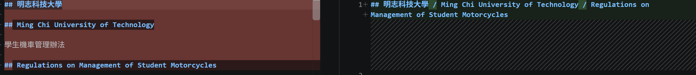
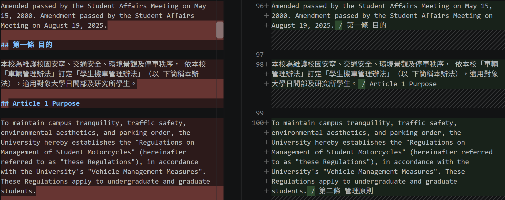
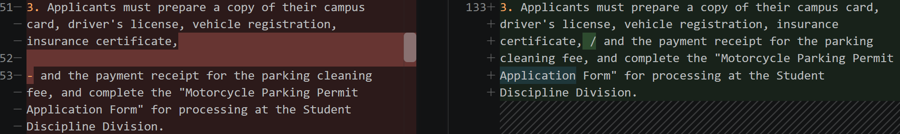
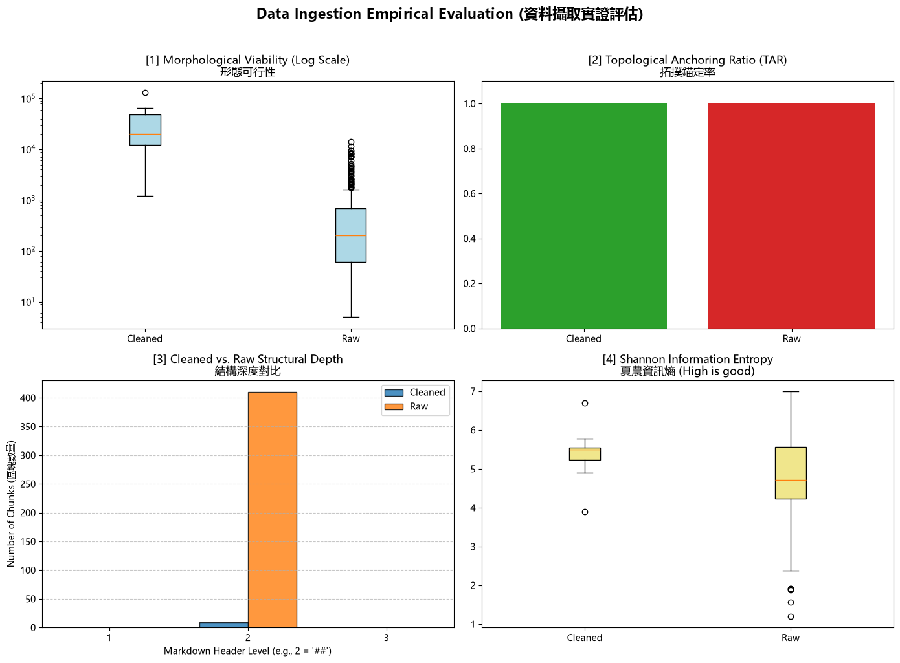

# 資料前處理報告 (Data Preparation Report)

> 期中評量 · NLP 自然語言處理 115-S1
> 填寫方式：請把所有「（ ）」與 `___` 替換成你自己的內容，並刪除 `>` 開頭的說明文字。

- **學號 / 姓名**：U12627010 / 李承勳
- **專案名稱**：nlp-mcut-qa-system
- **完成的任務**：- [x] 1-A 頁首頁尾清除　- [x] 1-B 雙語標題合併　- [x] 1-C 雙語條文合併

---

## 1. 資料集概覽 (Dataset Overview)


| 類別 (Cluster) | PDF 數量 | 清洗前 chunk 數 | 清洗後 chunk 數 |
|---|---|---|---|
|Academic_Affairs|3|96|3|
|Library_Information|3|248|3|
|Student_Affairs|3|66|3|
| **合計** |9|410|9|

**問題 (2–3 句)：** 清洗後 chunk 數量變少了多少？是哪個任務造成的？有沒有哪個任務**不影響** chunk 數量？為什麼？

清洗後 chunk 數量從 **410 個減少至 9 個，共減少 401 個（約 97.8%）**，主要是任務 **1-B（雙語標題合併）**造成的，因為第 5 節使用 `\n(?=##\s)` 作為 chunk 切割規則，合併標題會減少符合條件的切割點。任務 **1-C（雙語條文合併）**不影響 chunk 數量，因為它處理的是以 `-` 開頭的中英文條文，而不是以 `##` 開頭的標題。任務 **1-A（頁首頁尾／標題除噪）**則可能影響 chunk 數量，取決於刪除的內容是否包含切割標記。

___

## 2. 清洗步驟 (Cleaning Steps)

> **截圖來源：** `data/interim/<類別>/` 中的 `raw_*.md` (清洗前) 與 `cleaned_*.md` (清洗後)，也就是批次處理存下的**真實檔案**。
>
> **[重要] 不可使用 notebook 中的範例。** notebook 任務 1-A、1-B、1-C 的測試文字 (第二十一條、明志科技大學 / Ming Chi University of Technology、第十五條 / Article 15) **不能**作為你的截圖。請在真實檔案中**另找一處**，可以是其他 PDF 的檔案。使用範例的截圖**不給分**。
>
> **截圖方法 (VS Code 比較檢視)：**
> 1. 在檔案總管對 `raw_<檔名>.md` 按右鍵 → **Select for Compare**。
> 2. 對同一份文件的 `cleaned_<檔名>.md` 按右鍵 → **Compare with Selected**。
> 3. 左右並排顯示，紅色 = 刪除，綠色 = 新增或修改。按 `Ctrl + F` 搜尋，找到該任務造成的變更。
> 4. 每個任務截**一張**圖，存到 `reports/figures/`，**檔名必須完全相同** (否則圖片不會顯示)：
>    * 任務 1-A → `1a_compare.png`
>    * 任務 1-B → `1b_compare.png`
>    * 任務 1-C → `1c_compare.png`

### 2.1 任務 1-A：頁首頁尾溢出清除

- 檔名：A242100008_學生機車管理辦法　搜尋的文字：## 明志科技大學
- 截圖 (存為 `reports/figures/1a_compare.png`)：
- 改變了什麼：清除了部分重複的頁首、頁尾及多餘的 Markdown 標題格式，例如將原本分開的學校名稱、英文名稱與文件標題整理在一起，減少重複內容。
- 這對之後的問答檢索有什麼幫助：減少無關的頁面資訊干擾，讓檢索系統更容易找到真正的機車管理規定，提高搜尋準確度。
- 這個任務有沒有**改錯**的地方 (把不該改的也改了)？若有，寫出檔名與搜尋的文字；若沒有，寫「沒有發現」：有
- 檔名：cleaned_A242100008_學生機車管理辦法.md
- 搜尋文字：1
原始檔第二條「管理原則」的第四款中，因 PDF 換頁而出現獨立的頁碼 1，清洗後仍然保留，屬於沒有清除乾淨的頁面雜訊。
此外，清洗後文件仍保留末尾的 9 學生機車管理辦法Regulations on Management of Student Motorcycles，也是頁尾雜訊殘留。

### 2.2 任務 1-B：雙語標題合併

- 檔名：A242100008_學生機車管理辦法　搜尋的文字：## 明志科技大學
- 截圖 (存為 `reports/figures/1b_compare.png`)：
- 改變了什麼：將原本分開的中英文標題合併成同一行，並以 / 分隔，例如學校名稱「明志科技大學 / Ming Chi University of Technology」，減少標題分散的情況。
- 這對之後的問答檢索有什麼幫助：讓中英文標題能共同提供檢索線索，方便使用者以中文或英文搜尋相同規定，減少 chunk 被不必要地切開。
- 這個任務有沒有**改錯**的地方 (把不該改的也改了)？若有，寫出檔名與搜尋的文字；若沒有，寫「沒有發現」：有
- 檔名：cleaned_A242100008_學生機車管理辦法.md
- 搜尋文字：Article 1 Purpose
原本獨立的「Article 1 Purpose」被合併到第一條的中文正文後面，而「第二條 管理原則」又被接到第一條的英文正文後面，造成不同條文的標題與內容混在一起。

### 2.3 任務 1-C：雙語條文合併

- 檔名：A242100008_學生機車管理辦法　搜尋的文字：## 明志科技大學
- 截圖 (存為 `reports/figures/1c_compare.png`)：
- 改變了什麼：將部分原本分開的文字段落合併在同一行，使用 / 分隔，例如第三條英文申請文件說明與下一行文字被合併。
- 這對之後的問答檢索有什麼幫助：可以減少相關內容分散，讓檢索系統一次取得較完整的規定資訊，有助於回答問題。
- 這個任務有沒有**改錯**的地方 (把不該改的也改了)？若有，寫出檔名與搜尋的文字；若沒有，寫「沒有發現」：有 
- 檔名：cleaned_A242100008_學生機車管理辦法.md
- 搜尋文字：insurance certificate, / and the payment receipt
原本這兩段是同一句英文條文因換行而分開，清洗後卻加入 /，造成不必要的分隔符號，影響句子的完整性。

## 3. 評估指標與 AI 解讀查證 (Metrics & Verifying the AI's Interpretation)

### 3.1 指標數據表


| 指標 | Raw | Cleaned (你的) | Cleaned (參考值) |
|---|---|---|---|
| [1] 中位數長度 Median Length |205.0|20148.0	|270.5|
| [2] 拓撲錨定率 TAR |1.0|1.0|1.0|
| [3] 深度變異量 SDV (選填) |0.0|0.0|0.0|
| [4] 中位數資訊熵 Entropy (選填) |4.7200|5.5032|5.06231|  




你的 Cleaned 結果與參考值一致嗎？若一致，寫「一致」；若不一致，找出原因。（1 句）
- 我的 Cleaned 中位數長度遠高於參考值（20148.0 對 270.5），顯示清洗過程可能過度合併標題與條文，導致 Chunk 切割不當、資訊熵偏高，雖然 TAR 與 SDV 相同，但整體清洗品質仍未達到預期效果。

___

### 3.2 AI 的解讀

> 把第 3.1 節的儀表板截圖 (`dashboard.png`) 交給 AI，請它解讀結果。將 AI 的回答**完整貼在這裡**，並註明使用的 AI 工具。

- 使用的 AI 工具：ChatGPT_Plus

```text
圖表顯示清洗後雖然資訊熵提高、拓撲錨定率維持100%，但 Chunk 數量大幅減少且長度異常增加，顯示清洗過程可能過度合併內容，導致文件結構與檢索精準度受到影響。
```

### 3.3 你的查證 (至少兩點)

> 挑 AI 說得最肯定的兩句話，回到你的檔案或程式中找證據：它說的是真的嗎？

**查證 1**
- AI 的說法：Chunk 數量大幅減少且長度異常增加
- 我查了什麼 (哪個檔案、哪個 chunk、哪段程式)：___
- 結論：正確 / 部分正確 / 錯誤，因為 ___

**查證 2**
- AI 的說法：___
- 我查了什麼：___
- 結論：正確 / 部分正確 / 錯誤，因為 ___

### 3.4 實際證據：你被指定的 chunk

> 執行 `09_midterm_chunks.ipynb`：填入你的學號與老師在課堂上公布的 SEED，按 Run All。
> 每位同學拿到的 chunk 不同。請**連同驗證碼**一起填入。
> 程式只顯示前 400 字元的預覽。請在 VS Code 打開程式列出的**閱讀用檔案** (`data/interim/` 中的 `cleaned_*.md`，與 JSON 內容相同但有正常換行)，按 `Ctrl + G` 輸入程式給的**行號** (或按 `Ctrl + F` 搜尋「搜尋用」文字)，從該行讀到下一個 `## ` 標題為止，就是**完整**的 chunk。

- **SEED**：1106

**(a) 很長的 chunk**
- 資料檔 (JSON)：data/processed/Student_Affairs/cleaned_A242100008_學生機車管理辦法_processed.json　位置：第 0 個 (從 0 開始數)　長度：12290 字元 字元　驗證碼：7ef98216
- 閱讀用檔案 (`data/interim/Student_Affairs/cleaned_A242100008_學生機車管理辦法.md`)：　從第 1 行開始
- 前 3 行內容：
  ```text
  ## 明志科技大學 / Ming Chi University of Technology / Regulations on Management of Student Motorcycles

制定部門：明志科技大學生活輔導組

中華民國 114年08月19日修訂
  ```
- 這是什麼樣的文字？為什麼會這麼長？這個 Chunk 是《學生機車管理辦法》的完整規章內容，包含中英文條文、修訂紀錄、目錄及申請表，長度達 12,290 字元。因清洗時過度合併標題，導致原本應分開的條文失去切割點，使整份文件被合併成單一 Chunk。
- 之後做問答檢索時，這麼長的 chunk 可能造成什麼問題？容易混入大量與問題無關的資訊，增加模型處理成本，甚至超出上下文長度限制，降低檢索精準度與回答品質。

**(b) 資訊熵很低的 chunk**
- 資料檔 (JSON)：data/processed/Academic_Affairs/cleaned_A232060013_學生抵免學分辦法_processed.json　位置：第 0 個 (從 0 開始數)　資訊熵：3.89　驗證碼：f723fb7e
- 閱讀用檔案 (`data/interim/Academic_Affairs/cleaned_A232060013_學生抵免學分辦法.md`)：從第 1 行開始
- 內容：
  ```text
  ## 明志科技大學 / Ming Chi University of Technology / Regulations for Credit Transfer and Course Waiver of Students

制定部門：教務處

中華民國115年4月14日修訂
  ```
- 為什麼它的資訊熵這麼低？它對問答檢索有用嗎？《學生抵免學分辦法》包含大量重複的表格欄位、數字及固定格式文字，這類內容的字元分布較集中，可能造成資訊熵偏低；雖然對一般語意問答的幫助有限，但對查詢學分抵免規定、成績換算及申請表欄位仍有價值，因此不應只因資訊熵低就直接刪除。

## 4. 一個尚未解決的問題 (One Remaining Problem)

> 打開 `data/interim/` 中任一個 `cleaned_*.md` (與 `data/processed/` 的 JSON 內容相同，但有正常換行，比較好讀)，找出一個清洗後**仍然有問題**的 chunk。
> 每個 chunk 從一個 `## ` 標題開始，到下一個 `## ` 標題之前結束。
> 例如：只有標題沒有內文、表格亂掉、中英文沒有對齊、還有殘留的頁首頁尾、斷行造成的多餘空白，或是**清洗造成的錯誤** (誤合併、誤刪除)。
> **不可**使用第 3.4 節的兩個 chunk。

- **檔名** (`cleaned_*.md`)：___　**從第 ___ 行開始** (VS Code 左側的行號)　**標題**：___
- **我是怎麼找到的** (例如：搜尋了什麼、看了哪個檔案)：___
- **問題 chunk (貼上部分內容)**：

```text
（貼上）
```

- **問題是什麼**：___
- **可能的原因** (PDF 本身？Docling 轉換？清洗的正則表示式？切塊規則？)：___
- **具體的修正方法** (例如：一條規則、一個正則表示式的構想、長度上限)：___
- **對問答檢索的影響**：___

## 5. AI 協作 (AI Collaboration)

- 本次作業的 AI 協作紀錄請見 [`AI_USAGE.md`](AI_USAGE.md) 的「Week 04 / 08」與「Week 09」段落。
- 這次使用 AI 最大的收穫或教訓是 ___（請具體：例如提示詞中哪一段最關鍵、AI 哪一句解讀不正確）
